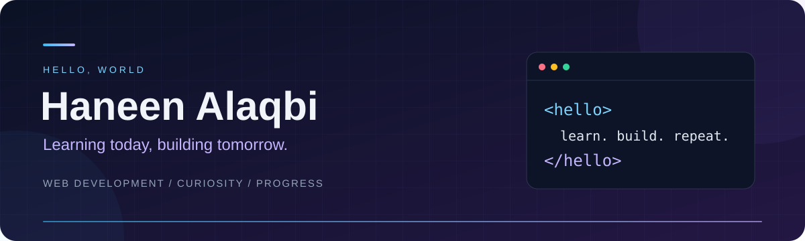

  

  <b>Learning web development, one project at a time.</b> 
  A space for my experiments, coursework, and progress.

  
  

## Hey, I'm Haneen 👋

I'm learning to turn ideas into web pages with HTML and CSS. This profile follows my progress as I practice, experiment, and build.

- 🌱 **Learning:** page structure, CSS styling, and web development fundamentals.
- 🛠️ **Working on:** my [CIS130 web development labs](https://github.com/halaqbi/CIS130).
- 🎮 **Away from the keyboard:** video games, music, and time with friends.

## My growing toolkit

  
  
  

## Featured project

### [CIS130 · My web development journey ↗](https://github.com/halaqbi/CIS130)

A collection of hands-on labs where I practice HTML and CSS, build web pages, and develop my foundation in web development.

**Focus:** semantic HTML · page structure · CSS styling

[Browse the code →](https://github.com/halaqbi/CIS130)

## Building consistency

[See my latest contributions and activity on GitHub →](https://github.com/halaqbi?tab=overview)

---

  <b>Learning today. Building tomorrow.</b> 
  Thanks for stopping by ✨

